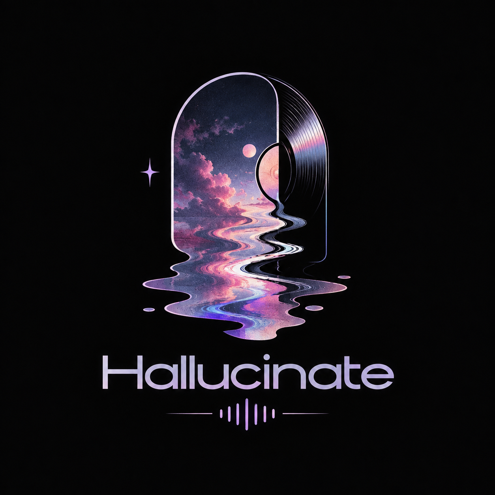
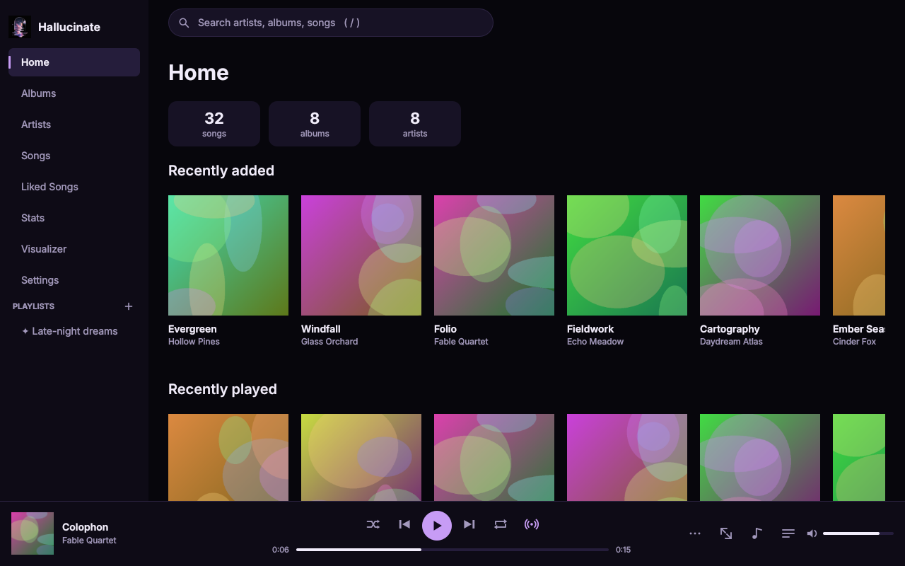
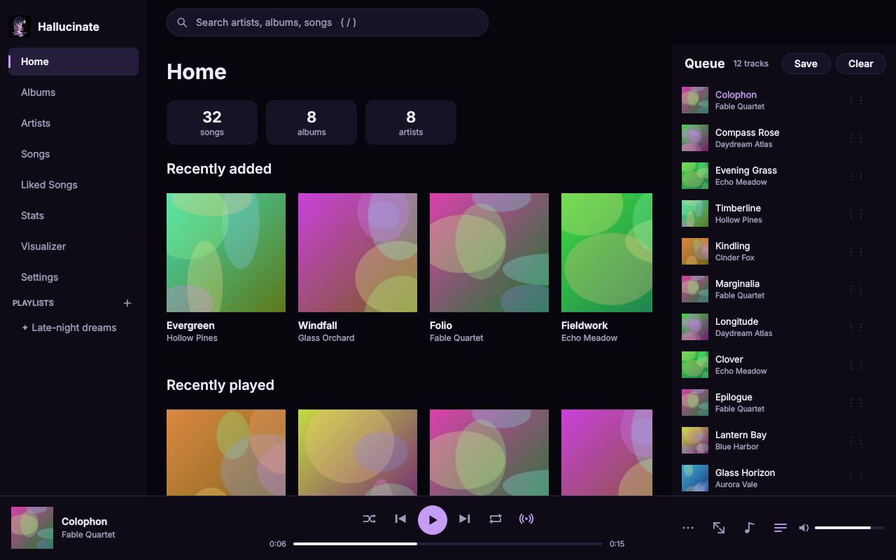
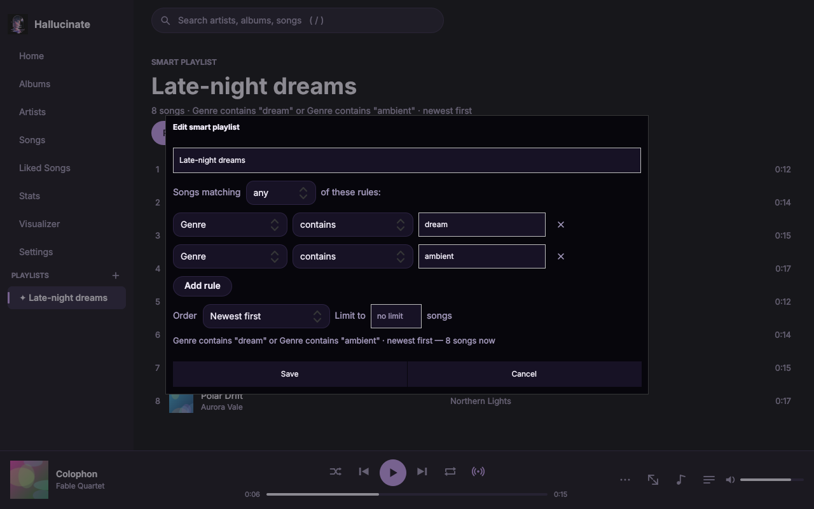
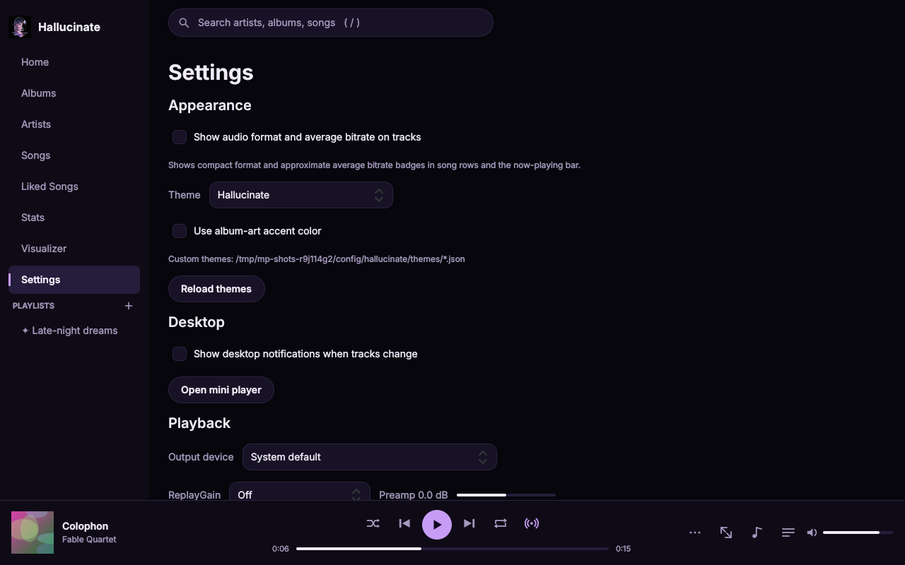
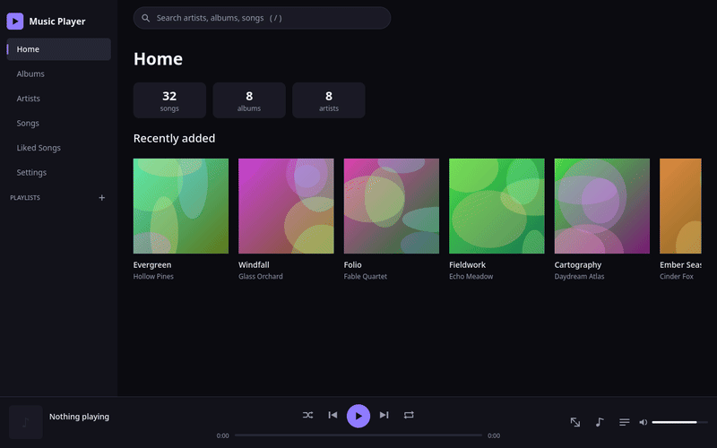

<p align="center">
  
</p>

<h1 align="center">Hallucinate</h1>

<p align="center">
  <b>A fast desktop music player for the music you own.</b><br>
  Soft, liquid and lit by your album covers. Gapless, private, and built around your own library.
</p>

<p align="center">
  <a href="https://github.com/Phosphene-dev/Hallucinate/releases/latest"></a>
  <a href="https://github.com/Phosphene-dev/Hallucinate/actions/workflows/ci.yml"></a>
  
  <a href="LICENSE"></a>
</p>

<h3 align="center">
  <a href="https://github.com/Phosphene-dev/Hallucinate/releases/latest/download/Hallucinate-windows-x64-setup.exe">⬇ Windows</a> &nbsp;·&nbsp;
  <a href="https://github.com/Phosphene-dev/Hallucinate/releases/latest/download/Hallucinate-x86_64.AppImage">⬇ Linux (AppImage)</a> &nbsp;·&nbsp;
  <a href="https://github.com/Phosphene-dev/Hallucinate/releases/latest/download/Hallucinate-macos-arm64.zip">⬇ macOS (Apple silicon)</a>
</h3>
<p align="center">
  <a href="https://phosphene-dev.github.io/Hallucinate/"><b>Website</b></a> · Flatpak, Arch (AUR) and pip: see <a href="#install">Install</a> · <a href="https://github.com/Phosphene-dev/Hallucinate/releases">all releases</a> · <a href="CHANGELOG.md">what's new</a>
</p>

<p align="center">
  
</p>

## Highlights
- **A look of its own.** Frosted glass over a backdrop that slowly drifts in the colours of the current cover, a floating player, and a waveform seek bar drawn from each song's own loudness.
- **Now Playing that fills the screen.** Press F: the cover, or the record sliding out of its sleeve, over GPU visualizers (Liquid, Aurora, Nebula, Halo, Waves) that move with the music in the cover's colours.
- **Home is about your library.** A random album to play, your listening heatmap and streak, albums to rediscover, what you played on this day in past years, and library facts.
- **Browse like a record shelf.** Album and artist pages, a colour wall that sorts every cover round the colour wheel, a timeline by decade and year, and your own folders.
- **Every listen remembered.** A searchable history of everything you played, recaps of every week, month and year, and your Last.fm, ListenBrainz or old player's history brought over.
- **Plays everything well.** FLAC, MP3, AAC/ALAC, Ogg, Opus, WAV, WavPack, AIFF and more, CUE sheet albums too, with true gapless playback, ReplayGain (measured where tags are missing), a 10-band equalizer, headphone correction and crossfeed, and a signal path readout that tells you when the sound is untouched.
- **Your music server too, if you have one.** Songs on a Jellyfin server, or a Navidrome, Gonic, Airsonic or other Subsonic server, join your library and play like your own files; songs from a server that can't be reached are skipped. Off until you switch it on in Settings → Features.
- **Internet radio and podcasts, if you want them.** Both are off until you switch them on in Settings → Features (where anything else you don't use can be switched off too). Stations come from their stream links or the Radio Browser directory and show the song they're playing; podcasts come from RSS feeds, the Apple Podcasts directory, OPML files from other apps or a folder of episodes, remember where you stopped, line up in an Up next list and have settings of their own, per show too. Neither ever counts toward your stats.
- **Radio mode and smart playlists.** Similar songs from your library keep playing when the queue runs out (songs you keep skipping come up less); playlists update themselves from rules, ratings included.
- **Fast to drive.** Instant search even across a quarter of a million songs, Ctrl+K for anything, Ctrl/Shift+click to act on many songs at once, and Ctrl+Z when the queue goes wrong.
- **Looks after your library.** A health check finds missing covers (and fetches them all at once), tags and folders, split albums and duplicates, with a fix next to each.
- **Make it yours.** Eighteen themes, any accent colour, light and dark that follow the system, a theme editor, an equalizer for each output device, and reduce motion for a stiller window.
- **No account, no cloud.** Your library, playlists and history stay on your computer. Scrobbling and Discord are opt-in, cover art is fetched only when you ask, and online lyrics lookup can be turned off. Back everything up to one file, and restore it anywhere.

## Help test it
Hallucinate is young and mostly tested by one person, so reports from other machines are the most useful thing
right now. Things worth trying:
- **Your real library,** especially a big one, odd tags, CUE albums and formats beyond FLAC and MP3.
- **Your desktop:** tiling window managers (Hyprland, Sway, i3), small windows, fractional scaling, Windows 10 and 11.
- **Gapless albums** on your audio device (live albums, classical, DJ mixes).
- **Imports** from Strawberry, Clementine, Rhythmbox, MusicBee, iTunes or foobar2000.
- **New in 0.9:** offline mode, Update now in the AppImage and Windows installer, the Flatpak repository,
  the restyled menus and dialogs, and crash reports.

Found something? [Open a bug report](https://github.com/Phosphene-dev/Hallucinate/issues/new/choose).
If Hallucinate crashed, it offers a report to copy the next time it starts: paste that in.
**Settings → About → Copy debug info** gives us everything about your setup in one paste, with your home folder
hidden. Thoughts, likes and dislikes are just as welcome in
[Discussions](https://github.com/Phosphene-dev/Hallucinate/discussions).

Known rough edges:
- The Windows and macOS builds aren't code-signed yet, so both systems warn on first launch (see [Install](#install)).
- Not on the AUR yet; use the AppImage or the Flatpak, or build the AUR package yourself from `packaging/aur/`.
- Hallucinate never sends anything about you or your library anywhere: there's no telemetry, and offline mode
  turns off every connection it does make.

## Screenshots
| Now Playing | Vinyl mode |
|---|---|
|  |  |
| Home | Album page |
|  |  |
| Colour wall | Timeline |
|  |  |
| History | Visualizer |
|  |  |
| Library health | Command palette |
|  |  |
| Right-click an album | Edit album |
|  |  |
| Queue with radio mode | Smart playlist rules |
|  |  |
| Artist page | Recap |
|  |  |
| Several songs selected | Folders |
|  |  |
| Settings | Pride themes |
|  |  |
| Internet radio | Podcasts |
|  |  |
| A show's page | The Ribbon theme |
|  |  |
| Halo visualizer | Waves visualizer |
|  |  |



_Screenshots are rendered from a synthetic library by `scripts/screenshots.py` (see its docstring for rendering the GPU visualizers headless)._

## Keyboard
| Key | Does |
|---|---|
| Ctrl+K or Ctrl+P | Command palette: any page, command, album, artist or song |
| / or Ctrl+F | Search |
| Space · N · P | Play/pause · next · previous |
| ← → · ↑ ↓ | Seek 5 s · volume |
| S · R | Shuffle · repeat |
| F · F11 · Esc | Now Playing · full screen · close |
| Q · L | Queue · lyrics |
| Ctrl+M | Mini player |
| Ctrl+1…5 · Ctrl+0 | Rate the playing song · clear its rating |
| Ctrl+click · Shift+click | Select songs · select a range (then act on them from the bar that appears) |
| Ctrl+Z | Undo the last queue change |
| Esc | Clear the selection |
| Alt+← · Alt+→ · mouse back/forward buttons | Back · forward, like a browser |
| Ctrl+Q | Quit |

## All features
- Scans folders (mutagen tags + embedded/folder cover art) into SQLite with FTS5 instant search; incremental rescans (mtime/size), background scanning, file watching, and removal of moved/deleted paths.
- Formats: FLAC, MP3, OGG/Vorbis, Opus, WAV, AAC/M4A, ALAC, WMA, APE, WavPack, AIFF and more (anything Qt's FFmpeg backend decodes). WAV/AIFF RIFF/FORM text tags are read; missing tags fall back to the filename and unknown values.
- Features (Settings): switch off Liked Songs, Folders, Stats, History, Recap, Visualizer, Library health, lyrics or any card on Home; it leaves the sidebar, Ctrl+K, links, buttons and shortcuts. Internet radio and podcasts start switched off. Rearrange the sidebar by dragging its entries, from their right-click menu, or in Settings.
- Internet radio: save stations by stream link (.pls/.m3u links are opened for the stream inside), import or export them as .m3u, or search Radio Browser. The song a station is playing (its ICY title) shows as artist and title in the app, the tray, media keys and Discord; dropped streams reconnect. Optional scrobbling of radio songs. Every song heard for a minute or more goes in a searchable "Heard on the radio" log, and the page shows how long you've listened and your top stations. Logos are cached, so nothing loads from the web in offline mode.
- Podcasts: follow RSS/Atom feeds, search the Apple Podcasts directory, import/export OPML, or add a folder of episode files. Resume where you stopped, played/unplayed, "Continue listening" and new episodes, downloads (by hand or automatically per show; removed once played if you like), chapters (Podcasting 2.0 and ID3/MP4), skip back and forward (15 s / 30 s by default, adjustable) and a speed of their own up to 3×. An Up next list across shows, new-episode notifications, show notes, search within a show, and Settings → Podcasts for refresh interval, what plays after an episode, when it counts as played, and which downloads to keep. Per show: newest or oldest first, hide played, its own speed, skip intro/outro and automatic downloads. Your listening (hours, episodes finished, top shows) on the Podcasts page; optional scrobbling of episodes. Episodes never count as plays.
- Home: a random album (roll again for another), a 26-week listening heatmap with your streak and this month's top artists, library facts (hours of music, size, lossless share, formats), albums to rediscover, "On this day" from past years, and recently added albums.
- History: every listen newest first, grouped by day with each day's plays and time; search it, narrow it to a period, a day on the 12-month heatmap, an artist or a source (played here or imported); play a song again or remove a listen (its play count follows).
- Album pages with liner notes (genre, format and sample rate, discs, size, date added, your plays with first and last listen, liked songs) and tracks split by disc. The Albums page also has a colour wall (covers ordered by measured colour, cached) and a timeline by decade and year.
- Now Playing (F): full-window view with the visualizer as backdrop, a large cover or a spinning record in its sleeve, a large waveform seek bar, and controls that fade when the pointer rests.
- Visualizers drawn with GPU shaders and tinted by the cover: Liquid, Aurora, Nebula, Halo and Waves (bars without hardware graphics), driven by the spectrum, smoothed band energies and a beat detector.
- Signal path readout: source format, ReplayGain, equalizer, speed, volume, crossfade and output device with its rate, marking which stages change the sound and when the system resamples.
- Library health: missing folders, untagged songs, split albums, missing covers, track numbers, years and genres, probable duplicates and low-bitrate files, each with a fix.
- Artist pages: a picture lit by its own colours, facts, your listening (plays, rank, first listen, plays per month), most played songs, the discography by year and albums they appear on; radio from their most played song.
- Recap: a week, month or year of listening summed up (time, top artists, albums, songs and genres, new artists, the busiest day, longest streak, when you listen), with a highlights card to save as an image.
- Folder view: browse your folders on disk with breadcrumbs, and play, shuffle or queue a folder with everything below it.
- Star ratings (1–5, alongside Like) from the track menu, the player or Ctrl+1…5; ratings are saved in the songs' own tags (POPM, RATING/FMPS_RATING, WMA's rating) so other players see them, ratings from other players' tags are read, and smart playlists can use them.
- CUE sheets: a single-file album with a .cue (or a sheet embedded in the file) appears as its separate songs, each with its own waveform, and plays gaplessly.
- First-run welcome: choose your music folders, a theme and scrobbling on a fresh install.
- Album menus and multi-select: right-click an album (or Ctrl/Shift+click several) to play, queue, add to a playlist, edit, remove from the library (files kept; Settings → Library brings them back) or move to the trash.
- Multi-select: Ctrl/Shift+click songs in any list, then play them, play them next, queue them, add them to a playlist, like, rate or edit their tags together.
- Queue undo (Ctrl+Z, 20 steps) for clearing, removing, moving and replacing the queue.
- Skip tracking: moving on from a song early counts as a skip; smart playlists can use skip counts and radio plays often-skipped songs less.
- Import from other players: play counts, skips, ratings and playlists from Strawberry, Clementine, Rhythmbox, MusicBee and iTunes, and foobar2000 play counts written to tags.
- Settings in searchable sections; Copy debug info for bug reports (no personal paths).
- Offline mode (Settings → Internet & sharing): one switch and Hallucinate makes no internet connections at all. Lyrics and cover lookups, scrobbling, headphone EQ downloads and update checks stay off; scrobbles wait and are sent when you switch it off. Every request in the code goes through one gate, and a test fails if anything bypasses it.
- Updates: an optional, off-by-default check (once a day, against GitHub). The Windows installer build and the AppImage can then update themselves with "Update now": the download is checked against the release's SHA-256 digest before it's installed. The Flatpak, AUR and other packages leave updates to their package manager.
- Command palette (Ctrl+K) with fuzzy matching over pages and commands plus albums, artists and songs.
- Global search grouped into Artists / Albums / Songs, plus Stations, Podcasts and Episodes when those are on; pages remember where you'd scrolled to; Home, Albums, Artists, Songs browse views; album and artist pages; editable queue; shuffle/repeat; seek; volume. Queue, current position, shuffle, repeat, and volume are restored after restart; missing queue files are discarded.
- Drag audio files or folders onto the window to play them (onto the queue panel to append); files outside the library play straight from their tags. Save the queue as a playlist from the queue panel.
- Smart playlists (Playlists → + → New smart playlist) that update live: combine rules on title, artist, album, genre, format, path, year, length, bitrate, sample rate, lossless, play count, date added, last played, liked and date liked, matching all or any, with a sort order and optional song limit. Examples: liked songs not played in 60 days; jazz before 1970; the 50 most played songs this year; lossless albums at 96 kHz or more. With radio on, a smart playlist keeps going with more songs that match its rules.
- Radio mode (the broadcast button next to repeat): when the queue is about to run out, similar songs from your library are added so playback keeps going. Picks are based on what you have listened to alongside the recent tracks, their artists, genres and years, with liked and often-played songs slightly favoured, recently played songs held back, and at most two songs per artist in each batch. Radio pauses while repeat is on.
- Choose the audio output device in Settings → Playback; the choice is remembered, and if that device is unplugged playback moves to the system default until it returns.
- MPRIS2 controls and media keys on Linux; on Windows 10/11, the system media controls (volume/media overlay, lock screen and media keys) with title, artist, album, artwork, timeline, seeking, shuffle and repeat.
- CLI controls (`hallucinate --next`, `--prev`, `--play-pause`) and JSON playback status (`--status`) through per-user single-instance IPC; optional desktop notifications on track changes.
- Optional Last.fm account linking, now-playing updates, 50%-or-four-minutes
  scrobbling, secure system-keyring credentials, a persistent offline retry queue, and optional two-way sync between Liked Songs and Last.fm loves.
- Liked Songs and user playlists (create, rename, delete, add from any track's "…" menu); the Stats page shows Recently played and a listening-based personal mix.
- A Stats page with top artists/albums/tracks and listening time for all time, the last 7 days, 30 days, or 12 months. Listening time is estimated from known track durations.
- Filter the library by genre, year, and format; find probable duplicate tracks by normalized title, artist, and duration. Manage multiple library folders in Settings.
- ReplayGain (track/album, preamp, read from tags, or measured with EBU R128 for files without tags, which are never modified; new music can be measured after each scan by itself), optional crossfade (0–12 s), gapless playback that plays every track to its last sample, and a 10-band equalizer with presets (needs numpy).
- The visualizer's FFT analysis runs on a worker thread and can be turned off ("React to the music").
- Optional compact format/average-bitrate badges in track rows and the now-playing bar (Settings → Appearance); the display is off by default, shows approximate average kb/s, and leaves unavailable bitrates out rather than displaying zero.
- Tag editor (single track or whole album; MP3, FLAC, Ogg/Opus, M4A, WMA, APE), with MusicBrainz lookup for a whole album's title, album artist, year, genre and track titles, a genre lookup for one album or (from Library health, reviewed before saving) every album without one, and cover art: set from an image file or fetch from MusicBrainz / Cover Art Archive, saved as `cover.jpg` in the album's folder and optionally embedded in the files. A cover you choose stays: the files' own pictures don't replace it.
- Headphone correction from AutoEQ's profiles (search by model, or import a ParametricEQ / GraphicEQ file), applied under the equalizer bands, and headphone crossfeed (light, medium, strong). Optionally a separate equalizer for each output device, switched as devices come and go.
- Lyrics panel with synced highlighting, and karaoke-style lyrics in Now Playing: embedded tags, sidecar `.lrc`, or LRCLIB (cached locally; switch it off in Settings → Internet & sharing). Nudge synced lyrics that run early or late and save the timing as an `.lrc` next to the song.
- Import M3U, M3U8 and PLS playlists (matched by path, then artist and title, then file name) and export any playlist, Liked Songs or the queue as M3U8.
- Backup and restore (Settings → Library): likes, ratings, playlists, play counts, listening history, folders, stations and podcasts in one `.hallucinate-backup` file; restoring merges, never deletes.
- Undo on the toasts after removing songs, clearing the queue, removing a station or marking a show played; a short What's new card after updates.
- Song and episode lists work from the keyboard (arrows, Page Up/Down, Home/End, Enter, Menu key).
- Mini player (always-on-top, `Ctrl+M`, with LIVE for radio and skip buttons for podcasts) and a system tray icon with play/pause/next/previous, optional close-to-tray.
- Keyboard focus rings, and a spoken name and role for everything you can click, type into or slide (a test walks every page as a screen reader sees it); renders crisply on HiDPI (tested at 2x).
- Live-switchable, file-backed themes with album-art accent mode and keyboard-friendly UI.

## Install
### AUR — **not yet published to AUR**
PKGBUILDs for `hallucinate` (latest release) and `hallucinate-git` (`main`) are in `packaging/aur/`; CI
builds, lints and launches the stable package in an Arch container. Until they are submitted, build locally:
```sh
cd packaging/aur/hallucinate && makepkg -si       # or packaging/aur/hallucinate-git
```
Maintainer and submission notes: [packaging/aur/README.md](packaging/aur/README.md).

### Windows
Download the [installer](https://github.com/Phosphene-dev/Hallucinate/releases/latest/download/Hallucinate-windows-x64-setup.exe), or the portable `hallucinate-*-windows-x64.zip` (run `Hallucinate\Hallucinate.exe`) from [Releases](https://github.com/Phosphene-dev/Hallucinate/releases). Windows 10 or 11; media keys and the system media overlay work out of the box. Built with PyInstaller (`packaging/windows/build.ps1`). The installer isn't code-signed yet, so the first time you run it Windows SmartScreen says "Windows protected your PC": choose **More info → Run anyway**. You can check the download against the SHA-256 shown on the release page. Last.fm credentials use Windows Credential Manager; data lives in `%APPDATA%\hallucinate`.

### AppImage (any x86_64 Linux)
Download the [AppImage](https://github.com/Phosphene-dev/Hallucinate/releases/latest/download/Hallucinate-x86_64.AppImage), then:
```sh
chmod +x Hallucinate-x86_64.AppImage && ./Hallucinate-x86_64.AppImage
```
Bundles Python, PySide6 and the Qt Multimedia FFmpeg backend. Build it yourself with `packaging/appimage/build.sh`.

### Flatpak
Hallucinate has its own signed Flatpak repository (it isn't on Flathub; the runtime still comes from there).
Install it once and it updates with your other Flatpak apps:
```sh
flatpak install --user https://phosphene-dev.github.io/Hallucinate/hallucinate.flatpakref
```
or open [that link](https://phosphene-dev.github.io/Hallucinate/hallucinate.flatpakref) in GNOME Software or
KDE Discover. Each release also has a single-file
[`.flatpak` bundle](https://github.com/Phosphene-dev/Hallucinate/releases/latest/download/Hallucinate-x86_64.flatpak)
(`flatpak install --user ./Hallucinate-x86_64.flatpak`), which sets up the same repository for updates.

The sandbox grants read-only access to `~/Music`; use the folder picker portal to grant access to other music
directories. To build it yourself, and how the repository is published:
[packaging/flatpak/README.md](packaging/flatpak/README.md).

### macOS
The release workflow builds a self-contained `.app` zip for the runner's native
architecture (Apple silicon). Download the [macOS zip](https://github.com/Phosphene-dev/Hallucinate/releases/latest/download/Hallucinate-macos-arm64.zip),
unzip it, and move `Hallucinate.app` to Applications. The build isn't signed or
notarized by Apple, so the first launch is blocked ("Apple could not verify…"). Open it once anyway in
**System Settings → Privacy & Security → Open Anyway**, or from a terminal:
```sh
xattr -dr com.apple.quarantine /Applications/Hallucinate.app
```
Build locally on a Mac with `packaging/macos/build.sh`.

### Arch Linux
```sh
sudo pacman -S pyside6 python-mutagen python-keyring python-numpy qt6-multimedia-ffmpeg
git clone https://github.com/Phosphene-dev/Hallucinate.git && cd Hallucinate
cd packaging/aur/hallucinate && makepkg -si      # or run from source (below)
```
### pip (any OS)
```sh
python -m venv .venv && . .venv/bin/activate
pip install -e '.[test]'
```
Note: a distro `pyside6` must match the installed Qt version; if you see
`undefined symbol` import errors, use an isolated venv (no system site packages)
so pip installs the PySide6 wheel.
Hallucinate requires Python 3.10 or newer and PySide6/Qt 6.11.2 or newer.

## Run
```sh
hallucinate                 # uses ~/Music on first run
hallucinate ~/Music /mnt/flac   # add folders
python -m hallucinate ~/Music
```
Folders can also be managed in Settings. Data lives in `~/.local/share/hallucinate`
(override with `HALLUCINATE_DATA`). On first launch, existing Music Player
library, settings, cache, themes, playlists, playback preferences, and Last.fm
keyring credentials are migrated without replacing data already at the new path.

## Performance

Scanning, database reads/writes, search and cover decoding all run off the GUI thread; lists and grids are
virtualized and thumbnails are cached under the data directory. `tests/test_performance.py` exercises a 50k-track
library and asserts the UI thread is never blocked for long. For bigger collections, `scripts/scale_check.py` runs
the whole app against a synthetic library (250,000 songs by default) and reports the worst stall for every page and
action, `scripts/startup_check.py` times each step of starting up on it and measures memory, and
`scripts/bench_library.py` times the queries behind them, and `scripts/soak_check.py` uses the app round and round to check its memory levels off instead of climbing. With 250,000 songs the window is up about 0.8 s after
launch and the library has loaded in the background a few seconds later.

## Privacy

Hallucinate has no accounts, no analytics, no usage pings and no install ID. Nothing is ever sent to the project. Your library, history, ratings and settings stay on your computer, in a data folder only your user account can open. Offline mode (Settings → Internet & sharing) stops every connection at once.

What does go online, and only when:

| What | When | What's sent |
|---|---|---|
| Lyrics (LRCLIB) | A song with no lyrics of its own starts; switch off in Settings → Internet & sharing | Artist, title, album, length |
| Covers and tags (MusicBrainz, Cover Art Archive) | Only when you click Find online, Find all, or Look up | Album and artist |
| Last.fm, ListenBrainz | Only after you connect your own account | What you play (scrobbles); keys stay in your system keyring |
| Discord status | Only if you switch it on; talks to the Discord app on your computer | The song, or just "Listening to music" in privacy mode. To show the cover, the album and artist are looked up on MusicBrainz (not when the cover is hidden) |
| Music servers | Only if you switch them on and add one | Requests to your own server only. The sign-in stays in your system keyring: for Subsonic, each request signs in with a one-time code; for Jellyfin, only the server's access token is kept, not your password |
| Internet radio, podcasts | Only if you switch them on and use them | Requests to the station or feed you chose; directory searches send your search words |
| Headphone EQ (AutoEQ) | Only when you search for headphones | The profile list is downloaded from GitHub |
| Update check | Off unless you switch it on; once a day | Asks GitHub for the latest version |

Crash records stay on your computer. When the app starts after a crash, it offers a report you can read and copy yourself. Debug info works the same way. Neither is sent anywhere, and both leave out song files, music folders, links and your user name.

## Last.fm
In Settings, enter the API key and secret for a Last.fm API application (create
one at [last.fm/api/account/create](https://www.last.fm/api/account/create)).
Credentials and the resulting account session are saved only through the system
keyring; the pending scrobble queue contains track metadata only. Connect, open
the authorization page in your browser, and confirm authorization in Settings.
Scrobbles are queued while offline and retried with backoff when connected.
On headless Linux, install and unlock a Secret Service-compatible keyring before
connecting. The app does not fall back to plaintext credential storage.

## ListenBrainz
In Settings, paste a ListenBrainz user token from
[listenbrainz.org/profile/](https://listenbrainz.org/profile/) and connect.
The token and account name are kept in the system keyring. Hallucinate updates
now-playing and submits listens when they meet the player listen threshold;
offline listens are stored locally and retried. The same page can import recent
listening history from either ListenBrainz or Last.fm by username. Imported
history is deduplicated and matched tracks update local listening statistics.

## Discord Rich Presence
Optional "Listening to" activity (title, artist, album, progress, cover via Cover Art Archive). Talks to Discord's local IPC directly (no extra dependency), runs off the GUI thread, and reconnects automatically if Discord is closed or started later. Works with native, Flatpak and Snap Discord on Linux, and on Windows.

1. Create an application at <https://discord.com/developers/applications> (its name is what shows as the activity title).
2. Under *Rich Presence → Art Assets* upload an icon named `hallucinate` (used when there is no cover or cover is hidden).
3. In Settings → Discord Rich Presence, paste the Application ID (or set `HALLUCINATE_DISCORD_APP_ID`) and enable it.

Options: hide when paused, hide cover, privacy mode (shows only "Listening to music"). Nothing is sent unless enabled; no application ID is bundled.

## Themes
Choose a theme in Settings. Built-ins are Hallucinate, Dark, Light, Catppuccin Mocha/Latte,
Nord, Gruvbox, Tokyo Night, Dracula and Ribbon (deep red), plus pride themes: Pride, Trans (dark and light), Bi,
Lesbian, Nonbinary, Pan and Ace. These are calm, readable themes in each flag's colours: the
flag shows in the drifting backdrop, as a slim stripe under the logo and in the accent, never
behind text. The optional album-art accent follows
the currently playing track; theme selection and this preference persist across
restarts. Any theme can take an accent colour of your own (kept readable against it), Hallucinate can
follow the system's light or dark mode with a theme picked for each, and **Make my own theme** starts an
editable copy of the current one. **Reduce motion** stops page transitions, zooms, the spinning record and
the drifting backdrop.

Add custom JSON files to `$XDG_CONFIG_HOME/hallucinate/themes/` (normally
`~/.config/hallucinate/themes/`) and select **Reload themes** in Settings.
Every theme requires all listed colors, a radius from 0 to 32, and a font family
with a size scale from 0.75 to 1.5:

```json
{
  "name": "My Theme",
  "colors": {
    "bg": "#111118", "panel": "#171720", "surface": "#22222d",
    "surfaceHi": "#30303d", "border": "#3c3c4b", "text": "#f5f5fa",
    "textDim": "#a3a3b3", "accent": "#76c7c0", "error": "#ff7777",
    "onAccent": "#101014"
  },
  "radius": 10,
  "fonts": { "family": "Sans Serif", "scale": 1.0 }
}
```

A theme may also list up to eight `"palette"` colours (as the pride themes list their
flags' stripes): they tint the backdrop and draw a stripe under the logo.

## Branding and icons
The full supplied logo is `assets/logo/hallucinate-logo.png`; the square app
mark and platform sizes are generated by `python scripts/make_icons.py`
(install with `pip install '.[icons]'`). Replace that source artwork and rerun the script; adjust
`MARK_BOX` there if the mark moves. The square crop retains the original black
background and is used for the app, tray, Discord fallback, and installers.
The original full logo is used above. The social preview
(`assets/logo/social-preview.png`) is built from the logo and the current Home
screenshot by `python scripts/make_social.py`; rerun it after new screenshots. To set it
on GitHub, use the repository's **Settings → General → Social preview** controls. The Windows installer uses
the generated setup wizard image.

## Command-line controls
Start Hallucinate normally, then control that running instance from a terminal:
```sh
hallucinate --play-pause
hallucinate --next
hallucinate --prev
hallucinate --status   # prints current track, state, position, duration, and queue length as JSON
```
The same local IPC activates the existing window when `hallucinate` is launched
again. Control commands report an error if no instance is running.
Track-change notifications are opt-in under Settings → Desktop; they use the
Linux desktop notification service or the platform tray notification API.

## Tests
```sh
pytest                      # core tests; the app smoke test runs offscreen
QT_QPA_PLATFORM=offscreen hallucinate ~/Music --quit-after 3000
```
Format and playback tests generate real files through `ffmpeg` (including seeking,
queue transitions and repeat/shuffle). Theme tests cover built-in and custom
files, preference persistence, art accents, and live QML updates. When `pulseaudio`
and `pactl` are installed, output-device tests switch, unplug and replug devices on
two PulseAudio null sinks (with and without the equalizer). A synthetic APE
header tests Mutagen tag and duration extraction only; it is not valid APE audio.
For release qualification, complete the [manual QA checklist](docs/manual-qa.md)
with representative files from your playback backend and device.

## Limitations
- Gapless playback uses two pre-rolled Qt players: each track plays to its last sample
  while the next one starts about 20 ms before it ends to cover its startup time. Joins
  measure within a few milliseconds on Qt 6.11, but the exact startup time depends on
  the audio device, so check a gapless album on each target system.
- Qt Multimedia uses the platform's default audio backend (the output device can be
  chosen in Settings). Hallucinate has no PipeWire-specific exclusive-output mode; see
  [the audio backend notes](docs/platform-audio.md) for details.
- macOS bundles are CI-built but unsigned and not notarized.

## Supported formats
FLAC, MP3, OGG/Vorbis, Opus, WAV, AAC/M4A, ALAC, WMA, WavPack, AIFF and APE
(metadata; decoding depends on your Qt FFmpeg build).

## Roadmap
- Signed Windows builds
- The AUR packages, once AUR account sign-ups reopen
- Real-device verification of APE playback and desktop media keys

## Contributing
See [CONTRIBUTING.md](CONTRIBUTING.md) and the [Code of Conduct](CODE_OF_CONDUCT.md). The calls that shape what
Hallucinate is and isn't are in [decisions.md](decisions.md).
Report vulnerabilities per [SECURITY.md](SECURITY.md). Changes are tracked in
[CHANGELOG.md](CHANGELOG.md).

## License
[MIT](LICENSE)
